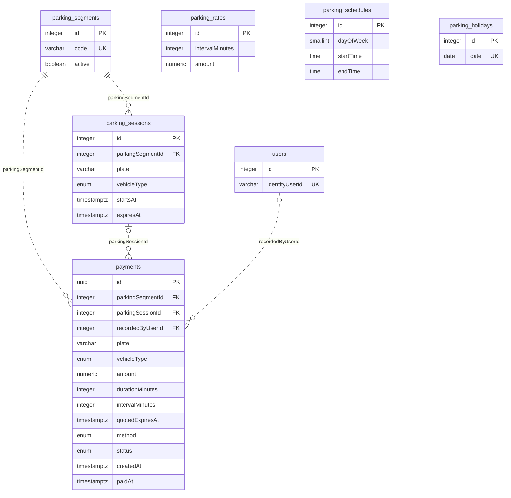

# Modelo de base de datos

El diagrama muestra las relaciones y los campos principales.

- Horario, feriados y tarifa se configuran de forma global. PostgreSQL impide los solapamientos entre intervalos del mismo día y limita la tarifa a una fila (`id = 1`).
- Un QR pendiente guarda el tramo, la placa y el tipo de vehículo para determinar la sesión al confirmarse. Solo los pagos confirmados pueden vincularse a una sesión. Una sesión puede reunir varios pagos, lo que conserva el importe y la fecha de cada ampliación.
- PostgreSQL exige que el efectivo tenga estado `confirmed`. La referencia al usuario que registró el pago admite un valor nulo mientras se prueba el efectivo sin autenticación.
