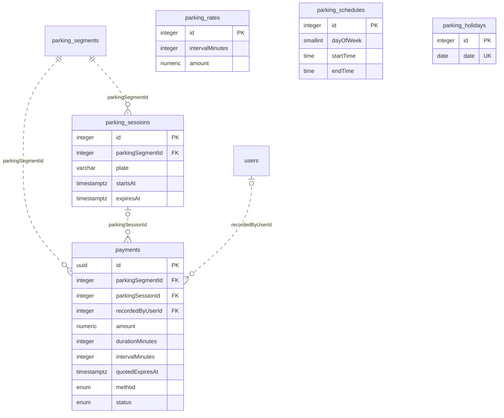

# Modelo de base de datos

- PostgreSQL limita `parking_rates` a una fila con la clave primaria y la restricción `id = 1`.
- El pago enlaza una sesión solo tras confirmarse. `recordedByUserId` es obligatorio para efectivo. La sesión usa `startsAt <= ahora < expiresAt` como vigencia.
- TypeORM sincroniza el esquema en desarrollo. Si conservas datos locales, consolida la tarifa en `id = 1` y rellena `payments.intervalMinutes` con el tamaño de bloque de las compras existentes antes de sincronizar. Para producción se requieren migraciones con `synchronize: false`.
