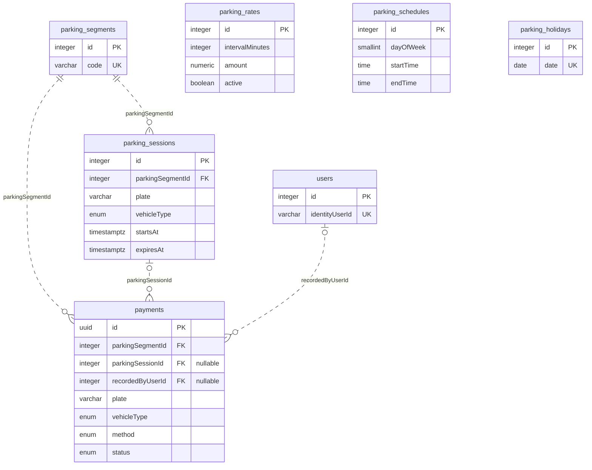

# Modelo de base de datos

El modelo actual contiene siete tablas. El diagrama muestra sus claves y los
campos principales; las entidades TypeORM son la referencia completa.

## Diagrama entidad-relación

`PK` indica clave primaria, `FK` clave foránea y `UK` unicidad. `||` significa
exactamente uno, `o|` cero o uno y `o{` cero o muchos. Todas las líneas representan
claves foráneas reales; el trazo discontinuo indica que no forman parte de la
clave primaria de la tabla dependiente.

## Responsabilidades

| Entidad (tabla)                         | Responsabilidad                                              |
| --------------------------------------- | ------------------------------------------------------------ |
| `User` (`users`)                        | Usuarios y roles; identifica a quien registra un cobro.      |
| `ParkingSegment` (`parking_segments`)   | Tramos donde se registra el estacionamiento.                 |
| `ParkingRate` (`parking_rates`)         | Tarifas por intervalo de tiempo y su activación.             |
| `ParkingSchedule` (`parking_schedules`) | Horarios definidos por día de la semana.                     |
| `ParkingHoliday` (`parking_holidays`)   | Fechas de feriados.                                          |
| `ParkingSession` (`parking_sessions`)   | Estacionamientos habilitados por placa, tramo y vigencia.    |
| `Payment` (`payments`)                  | Intenciones de pago y cobros, incluidos los de ampliaciones. |

## Relaciones principales

- Cada sesión y cada pago pertenecen obligatoriamente a un tramo mediante
  `parkingSegmentId → parking_segments.id`. Un tramo puede tener cero o muchas
  sesiones y pagos.
- Un pago puede estar asociado a una sesión mediante
  `parkingSessionId → parking_sessions.id`; la relación es opcional. Una sesión
  puede tener múltiples pagos, incluidos los de ampliaciones. La restricción
  actual exige que un pago con sesión asociada esté `confirmed`.
- Un pago puede identificar al usuario que registró el cobro mediante
  `recordedByUserId → users.id`. La relación es opcional en el esquema, pero
  obligatoria para pagos en efectivo, que además deben estar `confirmed`.
- `users.identityUserId` es un identificador único, sin relación TypeORM ni clave
  foránea declarada hacia otra tabla.
- `parking_rates`, `parking_schedules` y `parking_holidays` no tienen claves
  foráneas ni relaciones TypeORM con otras tablas.
